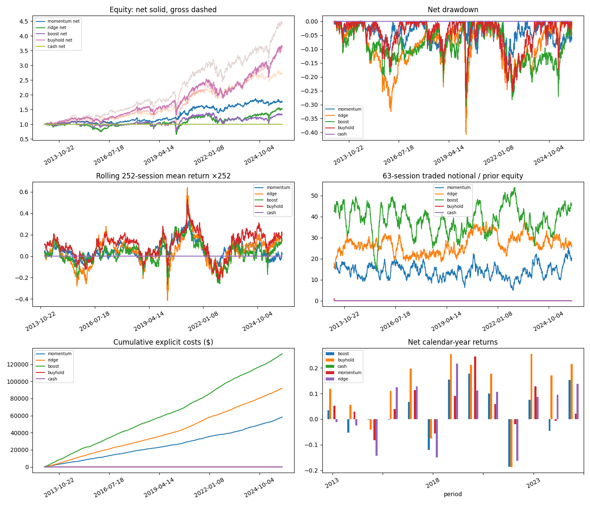
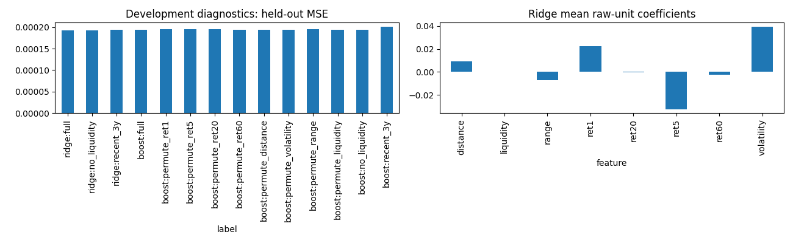

# Market Signal Lab

**HISTORICAL NORMALIZED-PRICE EXPERIMENT**

Decision: refine data and external validation; alpha is not established. These are generated artifacts from compiled C++ execution, not illustrative hand-entered numbers.

## Question and protocol
Do trailing daily price/liquidity features predict next-open to subsequent-open returns strongly enough to survive costs? Momentum hypothesizes persistence; Ridge additive relationships; boosting nonlinear interactions. See ../../docs/protocol.md and contracts.md. Universe is fixed across eight surviving ETFs, introducing retrospective selection bias.

| model    |   total_return |   gross_return |   max_drawdown |   turnover |   exposure |
|:---------|---------------:|---------------:|---------------:|-----------:|-----------:|
| momentum |         0.7537 |         1.7224 |        -0.1586 |   734.3381 |     0.7954 |
| ridge    |         0.5171 |         2.5000 |        -0.4078 |  1391.6816 |     0.8852 |
| boost    |         0.3228 |         3.4105 |        -0.3067 |  2005.1521 |     0.9522 |
| buyhold  |         2.6134 |         2.6140 |        -0.2768 |     0.9968 |     0.9984 |
| cash     |         0.0000 |         0.0000 |         0.0000 |     0.0000 |     0.0000 |

Evaluation is continuous from 2013 through 2025; periods.csv contains exact segment dates and counts, including the 2024–2025 retrospective holdout. Prices are real Yahoo Finance historical observations, normalized using the current adjustment vintage; see ../../docs/yahoo-data.md and store/metadata.json for provenance.

The first Ridge trade is traced in trade_trace.json from close-generated signal and forecast to eligible open, rounded shares, costs, cash and closing equity.

## Accounting and metrics
$100,000 initial capital; 1bp commission + 5bp adverse slippage per traded open notional; integer normalized shares, long only. Cash yields zero; gross is an independent zero-cost replay. Returns are close-to-close including initial trade costs. Annualization uses 252 sessions; Sharpe is mean daily return / sample standard deviation ×sqrt(252), zero risk-free rate. Undefined zero-volatility Sharpe is blank. Drawdown includes initial capital; duration counts sessions below the high-water mark. Turnover sums absolute traded reference notional / prior close equity (two-sided). Final holdings are marked, not liquidated. Buy-and-hold purchases equal weights once and has drifting exposures; active strategies carry cash and are not exposure-matched.

Max absolute accounting residual: 5.28e-11 dollars. Per-symbol attribution and positions reconcile to portfolio equity; costs are subtracted once. Stale marks and rejected orders are explicit.

## Evidence and limitations
momentum: net return 75.4%, gross return 172.2%, average exposure 79.5%, and two-sided turnover 734.3×. ridge: net return 51.7%, gross return 250.0%, average exposure 88.5%, and two-sided turnover 1391.7×. boost: net return 32.3%, gross return 341.1%, average exposure 95.2%, and two-sided turnover 2005.2×. These historical simulation differences show the effects of exposure, turnover and costs under the frozen policy; they do not establish risk-adjusted alpha or actual executable profits.

Predictive quality (MSE against zero; daily cross-sectional rank correlation) is in predictive_quality.csv. Eight symbols make daily IC unstable. Ridge raw-unit coefficients, training-only complexity comparisons, development ablations and permutation diagnostics are saved separately. They describe associations, not causal drivers. Transaction costs and changing exposure can overwhelm small predictive differences. Stress cases in stress.csv use half/double costs and an additional session delay, with identical frozen policy. No final results are used for selection.

Signal decay uses OOS signals only, with horizons 1/2/5/10 measured from executable open; overlapping observations and common market exposure invalidate IID significance. uncertainty.csv uses 200 circular moving-block bootstrap draws of 20-session portfolio returns. This is descriptive uncertainty, does not resolve multiple experimentation or regime change, and these intervals do not account for provider revisions or retrospective universe selection.

## Execution and replay
Synthetic intraday experiments use identical parent orders and a fixed prior-session volume profile. Fills occur at completed bar end with 10% participation; residuals carry within the day and cancel at its end. TWAP/VWAP change the holding horizon and are not market evidence. paper.sqlite is transactional historical replay, not a prospective live track record.

## Audit and next experiment
Tests cover future perturbation, fold purity, timing, independent Python/C++ accounting, costs, malformed contracts, cash limits, and replay idempotence. See verification.txt. Training boundaries and every attempted hyperparameter are in folds.csv and experiments.csv. Input, source, configuration and model hashes are in manifest.json.

The next justified experiment is independent-provider validation and point-in-time corporate-action accounting. Current-vintage adjusted prices can contain later revisions; absolute liquidity features and normalized share rounding can depend on future adjustments. This is a preliminary historical normalized-price experiment, not a point-in-time or live track record. Alpha and actual execution quality remain unestablished. The manual daily command imports completed sessions, rejects stale data, fits matured labels, and persists pending signals. Yahoo retrieval is available through research.download_yahoo; no prospective market observations have been accumulated.
